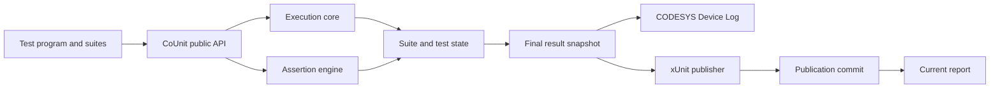

# CoUnit v2.0.0

CoUnit v2.0 is an independently maintained continuation and major rework of **CoUnit 1.2.0**, an xUnit-style unit-test framework for CODESYS.

The aim of v2.0 is to keep the familiar CoUnit test-authoring model while replacing unsafe, ambiguous, and hard-to-maintain internal behavior. Existing CoUnit-style tests should need little or no routine source change, but v2.0 does **not** aim for bug-for-bug compatibility with 1.x.

> **Status:** implemented and qualified on the Windows-1252 Windows x64 local simulator configuration recorded in [qualification/runtime-matrix.csv](qualification/runtime-matrix.csv). The packaged library is native version **2.0.0.0**. Other targets and native UTF-8 compiler configurations remain unqualified.

## Lineage

CoUnit v2.0 starts from the locally patched **CoUnit 1.2.0.3** library, derived from the original CoUnit 1.2.0 source base. The unmodified plaintext baseline is retained in `compatibility/1.2.0.3/`. The original project is MIT licensed, and redistributed derived source must retain its applicable copyright and license notices.

The v2.0 work uses the original CoUnit source as its compatibility baseline and as evidence of existing behavior. It also uses relevant TcUnit defects, fixes, and regression cases as supporting engineering evidence where the projects share related behavior.

For now, this maintained line remains named **CoUnit v2.0**.

## What stays familiar

The public programming model remains intentionally close to CoUnit 1.x:

- test suites extend `FB_TestSuite`;
- test code uses the established `TEST*`, `TEST_FINISHED*`, and assertion calls;
- test programs call `RUN()` or `RUN_IN_SEQUENCE()` on each scan;
- ordered and disabled/skipped tests remain supported;
- CODESYS Device Log output remains supported;
- xUnit/JUnit-style result files remain supported;
- existing configuration concepts and normal test-authoring source syntax are preserved where practical.

The major-version change is mostly about defined behavior, safe state handling, correct results, and reliable reporting rather than a new test DSL.

## Why v2.0

The 1.2.0 source contains several issues that are hard to repair safely as isolated patches. The v2.0 design therefore rebuilds the core behavior around explicit ownership and testable rules.

The work addresses problems including:

- fixed suite, test, and assertion storage that can be written past its configured bounds;
- assertion bookkeeping that can grow across scans or reuse stored values under the wrong type;
- ambiguous runner and sequential-execution completion state;
- skipped ordered tests blocking later tests;
- finish/query paths that depend on global current-test state;
- abort paths that can claim completion while work remains unfinished;
- incorrect aggregate result and assertion counts;
- xUnit output with wrong counts, unsafe escaping, fixed whole-document buffering, and weak file-error handling;
- unsafe generic `ANY`, `STRING`, and `WSTRING` handling;
- copy/paste errors across typed assertion methods;
- undefined or unsafe `REAL`/`LREAL` behavior around NaN, infinity, and tolerance values;
- global execution context that is unsafe when more than one CODESYS task enters the framework;
- logging paths that can drop valid messages.

## What changes in v2.0

### Explicit execution lifecycle

The runner owns one canonical run state instead of inferring completion from several counters and flags. A run moves through states equivalent to:

```text
IDLE -> RUNNING -> [BETWEEN_SUITES] -> FINALIZING -> COMPLETE
```

Run disposition is tracked separately as normal completion, abort, or framework error. Test failures remain test failures and do not become framework errors merely because an assertion failed.

This gives defined behavior for zero, one, or many suites; normal and sequential execution; sequence delays; repeated scans; abort/error finalization; and restart.

Current-run state is not retained. Reinitialization starts a new run instead of trying to resume a partial one.

### One task owns each run

A run binds to one CODESYS task. That task owns complex runner, suite, and test state.

Entry from another task becomes a framework error instead of allowing shared global state to be changed from two tasks at once. Concurrent multi-task execution of one CoUnit run is outside the v2.0 scope.

### Hard bounds before writes

Configured maxima are hard limits. v2.0 checks capacity before writing fixed suite, test, assertion, or result storage.

Capacity exhaustion must fail closed as a framework error. It must not cause an out-of-bounds write, a partial count update, or silent memory corruption.

### Defined test identity and terminal state

Tests have canonical identity within their suite and explicit lifecycle state. Skipped tests are terminal states rather than holes in the execution order.

Completion derives from canonical test state instead of a separate finished counter that can disagree with it.

### No persistent assertion-history table

CoUnit 1.x tries to track repeated assertions across scans. v2.0 removes that persistent assertion identity/history mechanism.

v2.0 instead:

- evaluates every executable assertion on every test-body invocation;
- stores no persistent expected/actual value history for repeat suppression;
- stores no inferred assertion call-site identity;
- records one first-failure detail record per failed test;
- continues to evaluate later assertions without replacing that first-failure record;
- enforces the configured assertion-call limit before changing assertion state.

The canonical assertion count for a test is the **maximum number of executable assertion calls seen in any single invocation of that test body during the run**. It is an execution-shape count, not a count of distinct assertion statements across every scan-dependent branch.

### Safer, shared assertion semantics

The assertion engine uses common comparison and result paths so typed methods do not drift apart.

The v2.0 contracts define:

- typed comparison independent from diagnostic formatting;
- bounded diagnostic text;
- checked `ANY` descriptors before dereference or copy;
- bounded logical comparison for `STRING` and `WSTRING`;
- bounded representation equality for unsupported same-type, same-size generic values;
- safe array shape and element comparison;
- local assertion failure for invalid assertion arguments that can be handled without aborting the run.

### Defined `REAL` and `LREAL` edge cases

Floating-point assertions explicitly define NaN, infinity, signed zero, invalid tolerance, and finite-tolerance behavior.

Values are classified from their raw representation before operations that could fault on unusual IEEE-754 values. The goal is a defined assertion result or local argument failure rather than an unexpected PLC runtime fault.

### One canonical final result snapshot

During finalization, v2.0 builds one canonical logical result snapshot. Device Log output, xUnit output, and retained legacy result views consume that snapshot rather than each deriving a different version of test truth.

The snapshot reconciles suite/test totals, passed/failed/skipped/error counts, assertion counts, terminal states, first-failure details, and final run disposition.

Report publication failure does not change whether a test passed or failed.

### More reliable Device Log output

Device Log reporting stays separate from test truth. Diagnostic strings are bounded, and logging paths that can discard otherwise valid messages are repaired.

### Streamed and escaped xUnit output

v2.0 replaces fixed whole-document XML construction with bounded streaming.

The reporting design includes:

- correct reconciled root and suite counts;
- publisher-owned XML escaping;
- bounded conversion and output chunks;
- explicit handling of the project's `STRING` encoding;
- qualified UTF-8 support and, where claimed, an explicitly identified legacy single-byte mapping;
- report-path checks based on stored byte length rather than character count alone.

### Report publication has a commit point

The configured current xUnit report changes only after a successful publication commit.

A failed or interrupted write must leave either the previous complete report or no current report if none existed before. A partial staging file must never be mistaken for a successful current report.

The exact file operation used to provide this guarantee may vary by qualified CODESYS target.

### Compatibility and qualification are explicit

v2.0 treats qualification as part of the product work rather than inferring broad support from one successful compile.

The qualification plan covers:

- known 1.x defect regressions;
- configured capacity boundaries;
- normal, sequence, skip, abort, restart, and cross-task behavior;
- floating-point and generic assertion edge cases;
- independent xUnit parsing and count checks;
- report-write and report-currentness fault cases;
- public API/source-surface checks;
- at least one real downstream CoUnit project compiled against v2.0 without routine test-source edits;
- exact CODESYS compiler/runtime/platform rows.

A failed, inconclusive, or unrun required check cannot be turned into a support claim by averaging it with passing checks.

## Compatibility policy

v2.0 aims to preserve **normal CoUnit test source compatibility** across the common `FB_TestSuite`, test, assertion, runner, Device Log, and xUnit usage model.

It does not promise compatibility with internal bugs, undocumented storage layout, or behavior that v2.0 deliberately corrects.

Some observable behavior is intentionally stricter or more precise:

- cross-task entry into one run is rejected;
- capacity exhaustion fails closed;
- skipped tests have explicit terminal meaning;
- abort/framework errors finalize unfinished work truthfully;
- assertion counting uses the v2.0 max-per-invocation rule;
- invalid generic and floating-point inputs have defined failure behavior;
- report publication state remains separate from test truth;
- a partial report cannot replace the current complete report.

Compatibility should therefore be established by both public-surface checks and real consumer compilation, not assumed from matching symbol names alone.

## Architecture at a glance



These are ownership boundaries inside one CoUnit library, not separate services.

## Scope and non-goals

CoUnit v2.0 is intended for **development and test use** on CODESYS systems.

The v2.0 plan does not add:

- a production-control runtime path;
- concurrent execution of one run from several PLC tasks;
- durable resume of a partial run after restart;
- a host service, network protocol, or database;
- a new test-authoring language;
- a wholesale import of newer TcUnit internals;
- support claims for CODESYS/runtime combinations that have not been qualified.

## Design areas

The v2.0 work is split into four main areas:

1. **Execution core and lifecycle** — runner state, suite/test lifecycle, bounds, ordering, task ownership, abort/error finalization.
2. **Assertion engine and safe comparison** — assertion bookkeeping, typed and generic comparisons, arrays, floating-point rules, first-failure handling.
3. **Results, logging, and xUnit publication** — final snapshot, Device Log, XML generation, file publication, and report currentness.
4. **Regression, compatibility, and qualification** — defect regressions, consumer compatibility, independent report checks, target/runtime evidence, and final support decisions.

## Installation and distribution

Install [counit_2.0.0.library](counit_2.0.0.library) through CODESYS Library Repository, then reference **coUnit - A unittest framework for CODESYS, 2.0.0.0 (www.co5e.org)** under namespace `CoUnit`. Disable **Qualified access only** on the reference when existing tests call unqualified `TEST()` and `TEST_FINISHED()`.

Instantiate the suite containers in the test program and call exactly one `CoUnit.RUN()` or `CoUnit.RUN_IN_SEQUENCE()` cyclically. The runner invokes registered suite bodies; do not separately call those bodies. Bind a fresh run-owned `CoUnit.GVL_coUnit.xUnitFilePath` before the first runner call. Use a relative writable runtime path, for example `CoUnit2/run-001.xml`, on the qualified simulator.

| Included path | Purpose |
| --- | --- |
| `counit_2.0.0.library` | Installable native library, with project settings and dependency references |
| `PlaintextExport/` | All 599 inspectable declaration/implementation sections |
| `generate_assertions.py`, `tools/`, `_tools/` | Assertion generation, native synchronization and qualification launch tools |
| `qualification/` | Fixtures, independent report oracles, coverage, exact runtime matrix and native evidence archive |
| `compatibility/1.2.0.3/` | Original plaintext compatibility baseline |
| `docs/CoUnit-PRD-Suite-R3/` | Supplied PRDs and contracts, preserved as received |
| `LICENSE` | Upstream MIT license and attribution |

The historical PRD packet's CANDIDATE/NOT_READY and NOT_RUN authoring labels are preserved as received. Current release outcomes are in `qualification/coverage.csv` and `qualification/runtime-matrix.csv`.

### Plaintext export format

`PlaintextExport/` uses a custom, self-developed format for inspecting source and reviewing Git diffs. It is neither the paid CODESYS File-Based Storage format nor PLCOpenXML. Directories mirror the CODESYS object hierarchy, including nested methods and properties. Each object's declaration is stored in `<ObjectName>.DEC.exp`; its implementation, when present, is stored separately in `<ObjectName>.IMP.exp`. These are ordinary text files, despite the `.exp` extension.

The supplied scripts synchronize this format with CODESYS through ScriptEngine; it is not a native CODESYS import format. The `.library` package remains necessary for the complete native project settings and dependency references. Generated `.xml` qualification fixtures are separate PLCOpenXML artifacts.

### Migration details

`ST_TestSuiteResults.NumberOfTestCases`, `NumberOfSuccessfulTestCases`, and `NumberOfFailedTestCases` are now **UDINT**, allowing all 65,536 configured tests. This changes the structure's binary layout; rebuild dependent applications and review any external binary mappings.

Every v2 report contains `counit-run-disposition`. Require `NORMAL` as well as correct inventory, fresh publication, and zero testcase failures/errors. A completed publication (`WRITTEN`) alone does not mean the run passed. Generic JUnit consumers may ignore this attribute; gate their input with:

```powershell
python qualification/verify_xunit.py path/to/fresh-report.xml --require-success
```

That command checks XML semantics and run disposition; the launcher must additionally bind freshness and the expected selected inventory. See [REPORTING.md](REPORTING.md). Legacy 1.x host runners are not automatically qualified for v2.

### Qualified results and limits

Qualification covered all 32 VER requirements and eight integrated scenarios on the exact Windows-1252 simulator row. It includes all 44 assertion families, 10,000-invocation behavior, capacity rejection guards, complete 65,536-pass and 65,536-failure inventories, task ownership, abort/restart, ordered and delayed sequence execution, actual Device Log byte capture, 17 publication fault/recovery cases, and 29 publisher edge cases. Expected failing assertions and injected failures are qualification stimuli, not passing product tests.

The saved, installed library compiled an unchanged downstream moving-average suite with **zero errors** and one existing UINT-to-INT warning in that consumer. All **8 tests / 30 assertions passed**, with NORMAL disposition and no skips. Source-import library qualification builds were zero-error and zero-warning.

The default 32-suite / 2,048-test-per-suite configuration has a **84,287,900-byte snapshot**. The full-capacity passing application used **206,946,402 bytes of global data**; allocate sufficient memory for the complete application. The measured simulator row had roughly 62 MB remaining in its configured data area. This does not establish a small-controller memory budget or task-deadline guarantee.

The qualified native compiler STRING mode is **Windows-1252**, not native UTF-8. Raw UTF-8 decoding, boundary truncation and XML conversion were exercised separately; they do not qualify a native UTF-8 project. Absolute filesystem paths were denied by this simulator, and very long expanded filesystem paths hit Windows limits. The 244-byte report-path / 255-byte companion-path contract passed exact byte and no-side-effect boundary checks; it does not promise every operating system can open such a path.

Native versions: CODESYS and simulator 3.5.22.20, compiler 3.5.19.70, SysFile 3.5.15.0, CmpIecTask 3.5.19.0, CmpLog 3.5.20.30. Actual resolved Device Log capture used a temporary test-only CmpLog 3.5.21.0 dependency; it is not a shipping dependency change. No physical controller was exercised.

### Development checks

Python 3.13, standard library only:

```powershell
python generate_assertions.py --check
python qualification/check_public_api.py
python -m unittest discover -s qualification -p test_host_tools.py
python qualification/generate_native.py
python qualification/check_runtime_matrix.py qualification/runtime-matrix.csv
```

Native tooling requires CODESYS, the MCP ScriptRunner extension, matching compiler/libraries and a disposable simulator project. Set `CODESYS_MCP_BRIDGE` if the bridge executable differs from the documented workstation default. See [qualification/README.md](qualification/README.md). Native editing tools require explicit paths; a saved-library consumer build is mandatory because matching source text alone cannot detect stale native language-model data.

## License and attribution

The original CoUnit source base is licensed under the **MIT License**, included in [LICENSE](LICENSE) from the [upstream v1.2.0.0 distribution](https://forge.codesys.com/lib/counit/code/HEAD/tree/tags/v1.2.0.0/license.txt?format=raw). CoUnit v2.0 is derived from that source and must retain the applicable upstream copyright and license notices when copied or distributed.

The v2.0 engineering work also draws on public TcUnit issue and fix history as regression and design evidence.

CoUnit started as a fork of [TcUnit](https://tcunit.org/) by Jakob Sagatowski, and we're grateful for all of his open source and educational efforts.
