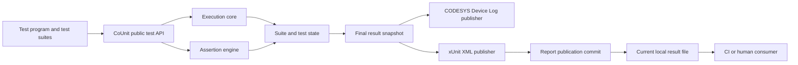

# CoUnit Architecture Rebaseline R3

**Package ID:** `COUNIT-ARCH-R3`  
**Revision:** `2026-09-09-r3`  
**Predecessor:** `COUNIT-ARCH-R2` / `2026-09-09-r2`  
**Task mode:** `REBASELINE`  
**Target maturity:** `PRODUCTION_INTENDED` for development/test environments  
**Package completeness:** `COMPLETE`  
**Approval state:** `APPROVED`  
**PRD authoring:** authorized by the 2026-09-09 architecture-owner approval recorded as `SRC-020`  
**Implementation/release authority:** not granted by this architecture package

## Purpose

R3 is the accepted successor to R2. It preserves the reviewed R2 architecture, packages the exact CoUnit 1.2.0.3 plaintext source used as `SRC-001`, records the architecture owner's approval, and closes the last shared assertion-semantics blocker without adding a fragile call-site identity system.

The operating result remains: existing CoUnit-style tests compile against the repaired library; normal and ordered runs terminate truthfully; multi-scan tests do not grow assertion-history storage merely because scans repeat; capacity failures fail closed; final counts reconcile under the explicit R3 count meaning; and xUnit output is valid and externally distinguishable from a failed or partial publication.

## R3 closure decisions

### Source and authority

- `SRC-001` is supplied at [`sources/CoUnitPlaintextExport.zip`](sources/CoUnitPlaintextExport.zip). Its SHA-256 is `458aab0070f01c7751f63bd7b0980ce7dc260a9607731646a900afedef1c6d48`, exactly matching the R1/R2 source identity. The archive contains 423 exported `.exp` sections plus its provenance README.
- `SRC-020` records the architecture owner's current instruction accepting R2 and accepting the recommended closure of `OPEN-COU-008`. This supplies the approval basis that R2 lacked.

### Assertion bookkeeping (`ADR-COU-017`)

R3 removes persistent per-assertion de-duplication identity from the architecture.

- Every executable assertion is evaluated on every test-body invocation.
- Each test tracks an invocation-local assertion ordinal, reset when that test body starts a new invocation.
- The canonical per-test assertion count is the **maximum number of executable assertion calls observed in any single invocation of that test body during the run**.
- Legacy `FB_Test.NumberOfAssertions` and `ST_TestCaseResult.NumberOfAsserts` project that metric. It is an execution-shape count, **not** a count of distinct source assertion statements across scan-dependent branches.
- Failure truth is independent of that count. The first failed assertion atomically sets the test's first-failure record and is the only assertion failure emitted as the test's detailed failure log. Later assertion calls still evaluate, but they do not need persistent assertion identity or duplicate-log state.
- No expected/actual value history, source-position key, message key, assertion slot table, or inferred call-site identity is used for repeat suppression.
- `GVL_Param_coUnit.MaxNumberOfAssertsForEachTestSuite` remains a hard guard for assertion calls in one suite-body invocation; exceeding it becomes a framework error before any count/storage write.

This choice preserves normal assertion-call source syntax and makes branch-dependent control flow unable to alias persistent assertion slots because no such slots exist.

## Architecture retained from R2

- one CODESYS library and one bound task per run;
- runner ownership of suite registration, invocation, run state and finalization;
- explicit run state separate from run disposition;
- hard pre-write bounds for fixed-capacity storage;
- canonical test identity and terminal skipped state;
- one canonical final result snapshot consumed by publishers;
- Device Log and xUnit publication kept separate from test truth;
- guarded REAL/LREAL and bounded generic `ANY` semantics;
- non-retained current-run state so restart/reinitialization starts a fresh run;
- external xUnit currentness changes only at semantic publication commit;
- no host service, network protocol, database, production-control path, or multi-task execution model added by this rebaseline.

`ADR-COU-007` remains historical and `CONTRADICTED`; `ADR-COU-017` is its approved successor.

## Systems and boundaries

The execution core is the only component that invokes registered suite bodies. The xUnit publisher may use staging files or another target-specific mechanism, but the configured current artifact must not expose a partial publication as current.

## Canonical records

- Architecture, requirements, quality and capabilities: [architecture-baseline.md](architecture-baseline.md)
- Decisions and authority: [decisions.md](decisions.md)
- Shared contracts and state/effect rules: [shared-contracts.md](shared-contracts.md)
- Verification, review coverage, gates and readiness: [verification-and-readiness.md](verification-and-readiness.md)
- PRD-authoring assignments: [prd-authoring-assignments.md](prd-authoring-assignments.md)
- Machine-readable handoff projection: [prd-authoring-handoff.yaml](prd-authoring-handoff.yaml)
- Source register: [sources.md](sources.md)
- Adversarial review and R3 closure record: [architecture-review.md](architecture-review.md)

## PRD readiness

| PRD | Scope | R3 status | Remaining nonblocking items |
|---|---|---|---|
| `PRD-COU-01` | Execution core and lifecycle | `READY_FOR_PRD` | `OPEN-COU-001` implementation repository/path |
| `PRD-COU-02` | Assertion engine and safe comparison | `READY_FOR_PRD` | `OPEN-COU-001` implementation repository/path |
| `PRD-COU-03` | Results, logging and xUnit publication | `READY_FOR_PRD` | `OPEN-COU-001`, `OPEN-COU-003` target publication mechanism |
| `PRD-COU-04` | Regression, compatibility and integrated qualification | `READY_FOR_PRD` | `OPEN-COU-001`, `OPEN-COU-002` future runtime matrix |

`READY_FOR_PRD` authorizes PRD elaboration only. It does not authorize implementation, deployment, release, or a runtime support claim.

## Reading routes

All architecture and source routes are package-relative.

- `PRD-COU-01`: this README → its assignment → architecture §§4–6, 10, 12–15 → `ADR-COU-001..006`, `008`, `015` → `IF-COU-001/002`, `ISC-COU-001/004`, `SDE-COU-001/002` → runner/suite/test/task objects inside `sources/CoUnitPlaintextExport.zip`.
- `PRD-COU-02`: this README → its assignment → architecture §§6–8, 12–15 → `ADR-COU-007..009`, `013`, `017` → `IF-COU-003`, `ISC-COU-002` → assertion/tracker/test failure objects inside `sources/CoUnitPlaintextExport.zip`.
- `PRD-COU-03`: this README → its assignment → architecture §§7–10, 12–15 → `ADR-COU-010..012`, `016`, `017` → `IF-COU-004/005`, `ISC-COU-003/004`, `SDE-COU-003` → result/log/XML/file objects inside `sources/CoUnitPlaintextExport.zip`.
- `PRD-COU-04`: this README → its assignment → architecture §§12–15 → all `VER-`, `SCN-`, gates and open items → shared contracts → check-specific source/test objects inside `sources/CoUnitPlaintextExport.zip`.

## Context assessment

The source archive contains 423 exported text sections, so PRD authors should retrieve only the named object families needed by each check rather than load the full export. The architecture routes separate common read-now material from check-specific source retrieval. No target model capacity was supplied, so this remains a context plan rather than measured model-fit evidence.

The R3 closure review was performed in the same assistant context as the R2 repair and therefore is not an independent post-repair review. A fresh worker-consumption check remains part of each downstream PRD's review policy.
