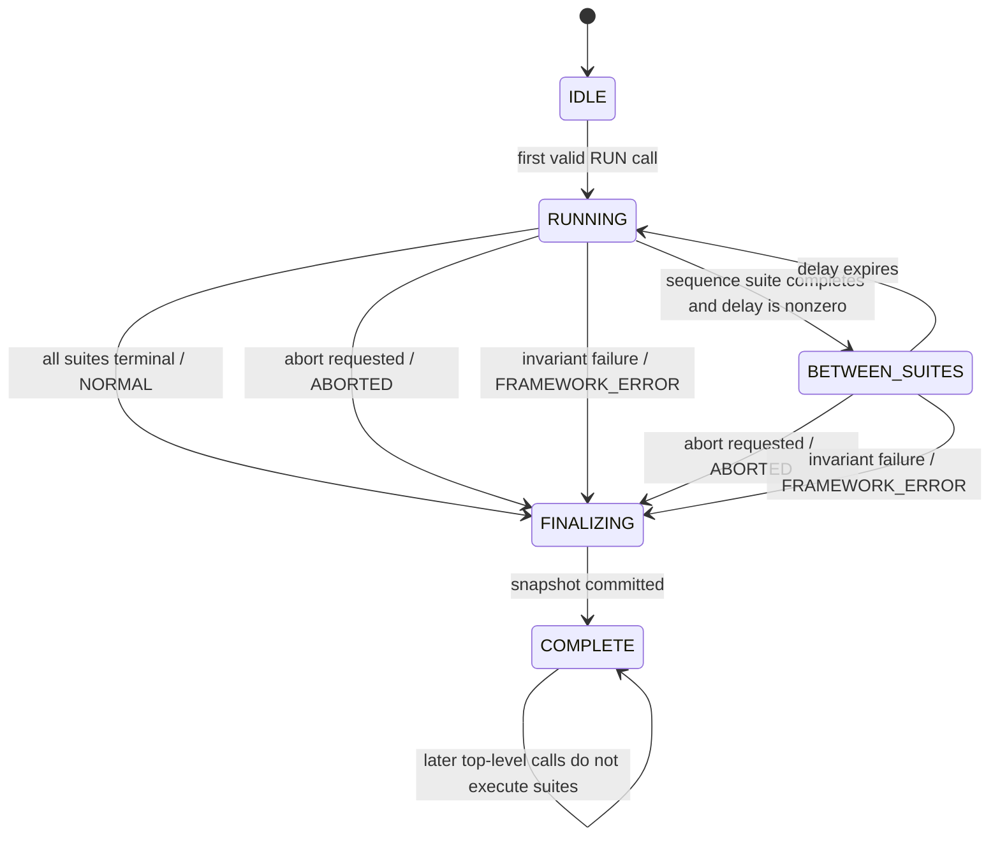
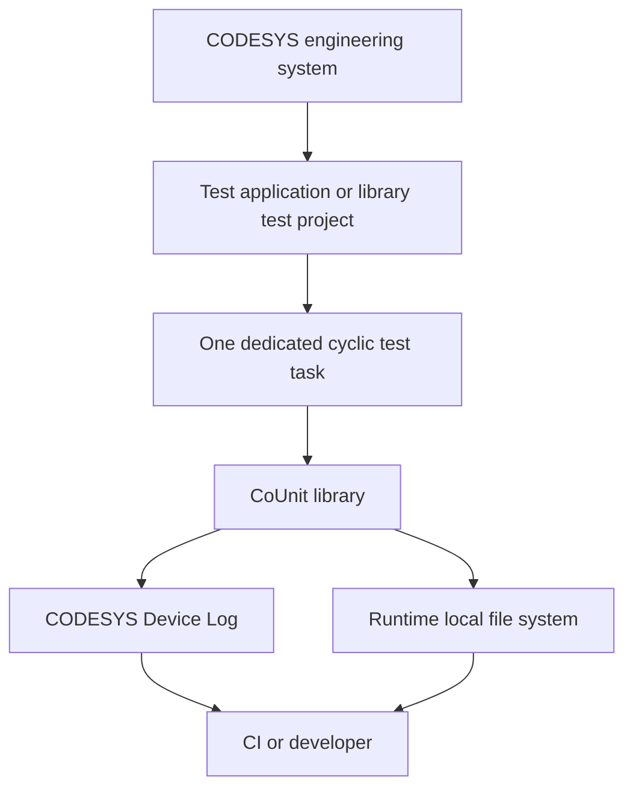

# Architecture Baseline — R3

**Package:** `COUNIT-ARCH-R3` / `2026-09-09-r3`  
**Predecessor:** `COUNIT-ARCH-R2` / `2026-09-09-r2`  
**Status:** `APPROVED`; package `COMPLETE`; `PRD-COU-01..04` are `READY_FOR_PRD` as scoped in `verification-and-readiness.md`.


## 1. Mission, maturity and operating boundary

**Input maturity:** existing working library with known defects and a completed initial defect review.  
**Task mode:** `REBASELINE`.  
**Target maturity:** `PRODUCTION_INTENDED` as a test/development library.  
**Runtime exposure:** CODESYS test applications and test tasks.  
**Production control exposure:** out of scope and not supported by this baseline.

The approved purpose remains an xUnit-style PLC unit-test framework. A test suite extends `FB_TestSuite`, test code uses the established `TEST*`, `TEST_FINISHED*` and assertion calls, and a test program calls `RUN()` or `RUN_IN_SEQUENCE()` on every scan.

This rebaseline changes internal ownership and state rules because the present design can corrupt memory, lose completion state, miscount results, emit invalid XML and crash on some assertion input patterns.

## 2. Actors and outcomes

| ID | Actor/viewpoint | Required outcome |
|---|---|---|
| `ACT-COU-01` | PLC test author | Existing tests remain easy to write and multi-scan tests behave predictably. |
| `ACT-COU-02` | Library maintainer | Internal state has one owner, hard bounds, small repair surfaces and testable rules. |
| `ACT-COU-03` | CI/report consumer | A completed run yields count-consistent, well-formed machine-readable results or an explicit report failure. |
| `ACT-COU-04` | CODESYS runtime | Framework code must not make out-of-bounds accesses, unsafe fixed-string copies or invalid floating-point operations. |

### Operational outcomes

- `OUT-COU-01`: run all registered suites to an unambiguous terminal state.
- `OUT-COU-02`: run ordered tests without disabled/skipped tests blocking later tests.
- `OUT-COU-03`: evaluate assertions every scan without assertion-history growth; emit one detailed first-failure event per failed test without storing expected/actual history.
- `OUT-COU-04`: fail closed when configured capacities are exceeded.
- `OUT-COU-05`: expose truthful final test results.
- `OUT-COU-06`: publish valid xUnit/JUnit-style XML or expose publication failure.
- `OUT-COU-07`: preserve normal public test-authoring source compatibility.

## 3. Current-state problems that drive the design

The rebaseline treats the following as observed defects or inherited risks, not as desired behavior:

1. assertion stores can exceed their configured arrays;
2. suite and test registration can index beyond configured arrays;
3. scalar assertion de-duplication in CoUnit 1.2.0.3 does not perform its intended search and does not update its stored cycle count;
4. value/union-based assertion history can reinterpret prior storage under a different type, a defect also reported against current TcUnit;
5. sequential runner completion state is not sound;
6. skipped ordered tests can block ordered execution;
7. named finish uses current-test global state in helper paths;
8. abort can make the runner claim completion while suites remain unfinished;
9. aggregate result arithmetic counts skipped tests as successful;
10. assertion counts are not copied into final test results;
11. xUnit output uses an incorrect root test count, lacks safe XML escaping, can exceed its fixed whole-document buffer and can report success after file I/O failure;
12. generic `ANY` STRING/WSTRING handling can copy source sizes into fixed 255-character locals before validating both operands;
13. several typed assertion methods contain copy/paste type mistakes;
14. REAL/LREAL handling has no explicit NaN/Inf/negative-delta contract;
15. current execution context is global and therefore unsafe for concurrent use from several tasks;
16. logging can discard messages that do not contain its `%s` placeholder.

## 4. Architecture elements and responsibility allocation

| ID | Element | Canonical responsibility |
|---|---|---|
| `ELM-COU-01` | Public API facade | Preserve existing public entry points and forward each call into the active execution context. |
| `ELM-COU-02` | Execution core / runner | Own run mode, run state, suite registry, execution epoch, active suite, task binding, abort/error transition and finalization trigger. |
| `ELM-COU-03` | Suite/test state | Own canonical test registration, names, order, skip state, terminal state, assertion count and first-failure record for one suite. |
| `ELM-COU-04` | Assertion engine | Evaluate typed/generic comparisons and report assertion outcomes into the current test without storing raw expected/actual history. |
| `ELM-COU-05` | Final result snapshot | Build one immutable logical snapshot during `FINALIZING`, after suite execution has stopped and the run disposition is fixed. |
| `ELM-COU-06` | Device Log publisher | Emit failure detail and final human-readable summaries with bounded strings. |
| `ELM-COU-07` | xUnit publisher | Stream escaped XML from the final snapshot and own file publication status. |
| `ELM-COU-08` | CODESYS platform adapter | Isolate task/cycle/log/file/time calls that depend on runtime APIs and validate pointer/result use. |

All elements remain inside the same CoUnit library. These are ownership boundaries, not separate deployment units.

### 4.1 Information and state ownership

| State/information | Canonical owner | Lifetime / writers | Projection or consumer rule |
|---|---|---|---|
| Suite registry | `ELM-COU-02` | Non-retained; written only through bounded pre-run registration | Registration order defines sequence order. |
| Run mode, execution state, disposition, epoch and task binding | `ELM-COU-02` | Non-retained; runner writes | No suite or publisher may maintain a competing completion fact. |
| Test records and terminal states | `ELM-COU-03` | Non-retained for the run; suite/test state writes under active runner context | Publishers read only through the final snapshot. |
| Assertion evaluation bookkeeping | `ELM-COU-04` + current test | Invocation-local ordinal plus per-test maximum count; no persistent per-assertion identity table. | No expected/actual history or call-site key is retained; first-failure state suppresses repeat failure detail. |
| Assertion count and first-failure record | `ELM-COU-03` | Updated only through `IF-COU-003` | Result snapshot copies them once at finalization. |
| Final result snapshot | `ELM-COU-05` | Created once in `FINALIZING`; immutable afterward | Legacy result objects, Device Log and XML are projections/consumers. |
| Report publication state and output file | `ELM-COU-07` | Publication state belongs to the current run; file becomes the current successful artifact only at `WRITTEN` | A failed/partial write is never evidence of current successful publication. |
| Device Log entries | `ELM-COU-06` | Append-only diagnostics | Logs do not own test truth. |

## 5. Execution core

### 5.1 Single-task invariant

One run is owned by one CODESYS task. The first valid `RUN()` or `RUN_IN_SEQUENCE()` call binds the run to that task. Later top-level run calls and all suite/test/assertion activity must occur under the same task.

A task mismatch is a framework error. CoUnit stops further suite execution and finalizes an error result. It must not continue with shared global context.

Multi-task concurrent test execution is deferred.

### 5.2 Run state and disposition

Canonical execution state:

```text
IDLE
RUNNING
BETWEEN_SUITES
FINALIZING
COMPLETE
```

Run disposition is a separate fact:

```text
UNSET
NORMAL
ABORTED
FRAMEWORK_ERROR
```

Test failures do not make the run disposition a framework error. `NORMAL` means the framework completed execution normally; individual tests may still have failed. The disposition is fixed when execution enters `FINALIZING` and is copied into the final result snapshot.



The implementation may complete `FINALIZING` in one scan. After `COMPLETE`, later `RUN*` calls do not execute test code; they may only advance output work that the selected publisher deliberately spreads across scans.

### 5.3 Run modes

`RUN()` selects `ALL_SUITES`. Each nonterminal suite is invoked once during each accepted runner epoch.

`RUN_IN_SEQUENCE()` selects `IN_SEQUENCE`. Only the active suite is invoked. When it becomes terminal, the runner advances to the next registered suite after the configured inter-suite delay.

The mode is fixed on the first top-level call. Calling the other mode later in the same run is a framework error.

The runner does **not** need a persistent “number of suites finished” counter. Completion is derived from suite terminal states in all-suites mode and from active-suite position plus terminal state in sequence mode.

### 5.4 Runner-owned epoch

The runner owns a monotonically increasing execution epoch, incremented once for each accepted top-level run invocation. Suite/test duplicate detection and assertion-cycle reset use this framework epoch rather than treating a runtime cycle counter as application state.

A CODESYS task/cycle query may be used to detect invalid duplicate top-level entry or task mismatch, but internal test identity does not depend on raw runtime cycle counters.

### 5.5 Suite registration

Test-suite `FB_init` registers the suite with the execution core through one bounded registration operation.

Rules:

- registration order is the suite order used by `RUN_IN_SEQUENCE()`;
- registration after the run has left `IDLE` is a framework error;
- `count >= MaxNumberOfTestSuites` rejects the new suite before any index write;
- a null or invalid registration pointer is rejected before storage;
- suite identity is the stable registry index for the life of the run.

The global raw array, if retained for compatibility, is an implementation projection. The runner is its owner.

### 5.6 Invocation context

Before calling a suite body, the runner establishes an internal context:

- run epoch;
- bound task identity;
- suite registry index;
- suite pointer;
- current test index, initially none;
- current assertion invocation ordinal, initially zero;
- `ShouldExecuteCurrentTest`, derived from test state/order.

After the suite body returns, the runner clears the active suite/test context. Calls to test/assert functions without a valid active context become framework misuse diagnostics rather than operating on the prior suite.

### 5.7 Reset, restart and rerun

All CoUnit execution, suite/test, assertion-slot and publication state used to decide the current run is non-retained. A CODESYS application reset, restart, download or library reinitialization starts a fresh run at `IDLE`; CoUnit does not attempt to resume a partly executed run.

This rebaseline adds no in-place public rerun/reset API. `COMPLETE` remains complete until normal application/library initialization occurs. A prior report file can persist on the filesystem, so `PRD-COU-03` must bind its file-currentness strategy to `IF-COU-005` and must never call an old or partial file the current run's successful report.

## 6. Suite and test lifecycle

### 6.1 Canonical test record

Replace the per-test `FB_Test` array and separate duplicate-trigger/cycle arrays with a compact internal test record. It owns at least:

- canonical test name;
- first-seen runner epoch;
- last-seen runner epoch;
- duplicate-reported flag;
- ordered flag and order number;
- terminal disposition;
- number of logical assertions observed;
- first-failure record.

The old `FB_Test` type may remain as a compatibility shell if required by library visibility, but it is not the canonical state owner.

### 6.2 Name rules

On each `TEST*` call:

1. trim leading/trailing whitespace;
2. detect `DISABLED_` case-insensitively at the start;
3. strip the prefix from the canonical stored/displayed name;
4. reject an empty canonical name;
5. compare canonical names case-sensitively, preserving existing normal name behavior.

The first registration fixes whether the test is ordered and whether it is skipped for this run. Later calls with the same canonical name but conflicting ordered/disabled shape are framework misuse.

A second encounter of the same canonical test in the **same runner epoch** is a duplicate-definition error for that scan. A later-epoch encounter is the normal way a multi-scan test continues.

### 6.3 Test terminal state

Canonical terminal states:

```text
OPEN
PASSED
FAILED
SKIPPED
ABORTED
ERROR
```

`OPEN` is the only nonterminal state.

A failed assertion sets an internal `HasFailure` fact immediately. `TEST_FINISHED*` changes an `OPEN` test to `FAILED` when `HasFailure=TRUE`, otherwise to `PASSED`.

`SKIPPED` is terminal as soon as the disabled test is registered. It does not need `TEST_FINISHED()` to allow suite completion, though a later `TEST_FINISHED()` call for the same skipped test is harmless and idempotent.

When the run aborts, all known open tests become `ABORTED`. When the framework can no longer trust execution state, affected known open tests become `ERROR`.

### 6.4 Ordered execution

Each ordered test receives a stable order number on first registration. The suite keeps an ordered cursor.

`TEST_ORDERED(name)` returns `TRUE` only when:

- the test is enabled and open;
- its order number is the current ordered cursor; and
- the run/suite context is valid.

The ordered cursor advances across every terminal ordered state, including `PASSED`, `FAILED`, `SKIPPED`, `ABORTED` and `ERROR`. A skipped ordered test can never block a later test.

Cursor advancement must check the configured order capacity before incrementing. The terminal “past last ordered test” condition uses an explicit sentinel/state, not an out-of-range constrained integer.

### 6.5 Named finish

`TEST_FINISHED_NAMED(name)` resolves the supplied canonical name and finalizes that record. It does not use the global/current test name for lookup, assertion counting or path construction.

Finishing a non-current test does not change the current test's `ShouldExecute`, assertion invocation ordinal or terminal state.

An unknown named test is a localized test-author misuse: report a bounded diagnostic and make no state change. It does not by itself corrupt the active run context or force run finalization.

## 7. Assertion architecture

### 7.1 No persistent assertion identity/history

The current suite-wide scalar/array assertion trackers are removed from core behavior rather than replaced with another inferred identity table. The existing `GVL_Param_coUnit.MaxNumberOfAssertsForEachTestSuite` limit remains operative, but R3 gives it an execution meaning rather than a history-slot meaning: it bounds assertion calls in one invocation of a test-suite body.

At runner entry to each suite-body invocation, reset `SuiteInvocationAssertionCount := 0`. Each accepted current-test segment starts with that test's `InvocationOrdinal := 0`. Every executable assertion call then:

1. checks `SuiteInvocationAssertionCount < GVL_Param_coUnit.MaxNumberOfAssertsForEachTestSuite`; if false, raise a framework error before either counter is incremented or any assertion result state is written;
2. increments `SuiteInvocationAssertionCount` and the current test's invocation-local `InvocationOrdinal`;
3. updates the test's `MaxAssertionsPerInvocation := MAX(MaxAssertionsPerInvocation, InvocationOrdinal)`;
4. performs the comparison;
5. reports pass/fail to the current test;
6. stores no raw expected/actual value or call-site identity for repeat detection.

The invocation ordinal resets when a test body begins its next invocation. `MaxAssertionsPerInvocation` lasts for that test's current run and is the canonical source for the legacy assertion-count projection.

### 7.2 Assertion count and failure-log semantics — approved R3 rule

`ADR-COU-017` closes R2's assertion-identity blocker:

- there is **no stable logical assertion-call-site identity** in the core architecture;
- `FB_Test.NumberOfAssertions` and final `ST_TestCaseResult.NumberOfAsserts` mean the **maximum number of executable assertion calls observed in any single invocation of that test body during the run**;
- this count is an execution-shape metric. It does not claim to count distinct source assertion statements across mutually exclusive branches or across scans;
- every assertion still evaluates every time its call executes. A branch-B assertion at ordinal 1 is never skipped merely because branch A used ordinal 1 on another scan;
- detailed assertion failure output is tied to the atomic first-failure transition. The first failed assertion sets `HasFailure` plus the first-failure record and emits the detailed failure event. Later assertions continue to evaluate but do not need a persistent de-duplication key or additional detailed failure log;
- the final result snapshot copies `MaxAssertionsPerInvocation` once. Publishers do not infer a different count from failure records.

For the R2 adversarial branch case, if scan 1 executes A at ordinal 1 and A passes, then scan 2 executes B at ordinal 1 and B fails, B must set the first-failure record. The final assertion count is `1`, because each body invocation executed one assertion. That is intentional and no longer presented as a distinct-call-site count.

This design removes the source framework's value/message/path assertion-history mechanism and the R1 ordinal-slot replacement. It keeps normal public assertion calls unchanged and makes repeated scans unable to grow assertion-history memory.

### 7.3 First failure

Each test owns one atomic first-failure record:

```text
IsSet
AssertionType
Message
ExpectedText
ActualText
```

All fields are written together only on the first failed assertion. Later failures never replace part of that record.

Diagnostic expected/actual text is bounded and safely truncated for display. It is not used to decide equality.

### 7.4 Typed assertion core

Public typed assertion methods remain. Their repeated flow must be reduced to a small set of internal comparison/report helpers so assertion type, formatting and tracking cannot drift across dozens of copy/paste methods.

All scalar and array REAL/LREAL checks share one floating-point rule:

- `Delta` is NaN or `Delta < 0`: fail the assertion with an invalid-delta diagnostic; perform no unsafe arithmetic;
- if either expected or actual is NaN, the values are not equal, including NaN vs NaN;
- same-sign infinity vs same-sign infinity: equal;
- other cases containing infinity: not equal;
- finite values: equal when `ABS(Expected - Actual) <= Delta`.

`Delta` is an absolute tolerance. Array REAL/LREAL comparisons apply this same rule per element.

### 7.5 Generic `AssertEquals(ANY, ANY)`

The public generic assertion remains source-compatible but receives strict safe dispatch:

1. validate both `ANY` descriptors before any copy/read;
2. if type classes differ, report inequality without reading either value as the other type;
3. STRING and WSTRING compare logical content directly within each operand's declared size; never copy arbitrary operand size into `T_MaxString`;
4. known primitive types dispatch to the same typed comparison helpers;
5. equal non-string, unsupported/user-defined types preserve the existing representation-equality behavior by comparing exactly `diSize` bytes only after equal type and equal size checks;
6. null/invalid value pointers or invalid sizes fail safely with a diagnostic rather than dereference.

Representation equality for user-defined `ANY` values is explicitly documented as bytewise equality; it is not promoted to semantic object equality.

## 8. Result model

### 8.1 Canonical snapshot

The execution core builds one canonical result snapshot only after the run enters finalization. No publisher polls partially changing suite/test state to decide final counts.

The canonical snapshot contains:

- run terminal disposition;
- suite count;
- test count;
- passed count;
- failed count;
- skipped count;
- aborted/error count;
- each suite identity/name and reconciled counts;
- each test canonical name, class/suite name, terminal state, maximum-per-invocation assertion count and first-failure record.

Invariant:

```text
total tests = passed + failed + skipped + aborted/error
```

The same invariant holds per suite.

### 8.2 Legacy public result projection

Existing public `I_TestResults`, `ST_TestSuiteResults`, `ST_TestSuiteResult` and `ST_TestCaseResult` remain source-compatible unless a later approved compatibility decision says otherwise.

Where the legacy structure cannot express the richer canonical state:

- successful counts exclude skipped and error/aborted tests;
- existing skipped booleans remain truthful;
- existing failed booleans represent assertion failure, not framework abort/error;
- new internal publishers use the canonical snapshot rather than guessing missing state from the legacy projection.

Any additive public fields require a PRD compatibility review before adoption.

## 9. Logging and xUnit publication

### 9.1 Device Log

The log adapter accepts complete messages. A message does not need a `%s` placeholder to be emitted.

Failure diagnostics may span bounded lines for path, expected, actual and message. Long text is deliberately truncated with an explicit marker rather than overrunning a fixed buffer.

`LogExtendedResults=FALSE` suppresses optional verbose result detail only. It must not suppress:

- failed assertion diagnostics;
- framework errors;
- final pass/fail/skip/error summary;
- xUnit publication failure.

### 9.2 xUnit/JUnit-style XML

The publisher owns XML escaping and file publication.

Required semantics:

- root `tests` equals total test cases;
- suite `tests` equals suite total;
- `failures` counts assertion-failed tests;
- `skipped` counts skipped tests;
- `errors` counts framework-error/aborted tests where represented;
- a skipped case uses `<skipped/>`;
- an assertion-failed case uses `<failure>`;
- a framework-error/aborted case uses `<error>`;
- names, messages, type text and all other inserted values are escaped for XML 1.0;
- invalid XML code points are replaced or encoded by one defined safe policy;
- output size is not limited to one whole-document in-memory buffer.

The publisher streams through a bounded chunk buffer. The buffer must always reserve required terminator/sentinel space. A full buffer is flushed before more content is appended.

### 9.3 Publish state

Canonical report state:

```text
DISABLED
PENDING
WRITING
WRITTEN
FAILED
```

`WRITTEN` is reached only after the complete document has been written and the file has closed successfully.

File delete/open/write/flush/close errors transition to `FAILED`, emit an error log and suppress any “exported successfully” message.

The exact portable commit mechanism remains delegated to `PRD-COU-03`, but the shared external contract is no longer optional:

- bytes written before semantic commit are staging output, never the current successful report;
- a failed open/write/flush/close/replace step leaves the current successful artifact unchanged or absent;
- the configured current artifact changes only after the complete XML document is closed and the chosen commit step succeeds;
- restart/reinitialization while publication is in progress must not make a partial staging artifact current;
- a direct write to the configured current path is allowed only if the target/runtime plus consumer protocol prove the same invariant. Merely setting internal state to `FAILED` is not enough for a file-only consumer.

This is `ADR-COU-016` / `REQ-COU-036`; `OPEN-COU-003` still delegates the target-specific mechanism.

## 10. Platform adapter and resource safety

Runtime-specific calls are isolated behind `ELM-COU-08` and governed by `ISC-COU-004`. `PRD-COU-01` owns task/project-call contributions; `PRD-COU-03` owns file/log-call contributions. Neither may create a second, conflicting platform-failure policy.

The adapter must check return codes and pointers before dereference for:

- current task information;
- project information where still needed;
- file operations;
- log operations where status is available.

The repair should remove uses of current-task cycle count that exist only to compensate for missing framework-owned lifecycle state.

All fixed-capacity arrays follow one rule:

```text
check capacity -> choose valid index -> write -> commit count
```

No code increments the count and then discovers it exceeded the capacity.

## 11. Deployment and operating view



The framework does not own application I/O and does not disable physical devices. A project that might actuate real equipment while running unit tests must provide its own test/simulation boundary. CoUnit itself must not add a new physical-effect path.

## 12. Requirements

| ID | Requirement |
|---|---|
| `REQ-COU-001` | Existing normal test-authoring public entry points and signatures remain source-compatible unless an explicit later compatibility decision approves a break. |
| `REQ-COU-002` | One run binds to one test task; cross-task use is detected and stopped safely. |
| `REQ-COU-003` | The runner is the sole suite-body invocation authority. |
| `REQ-COU-004` | Suite/test/assertion indices are checked before every bounded write. |
| `REQ-COU-005` | Suite registration at capacity+1 must not alter registry memory or counts. |
| `REQ-COU-006` | Test registration at capacity+1 must not alter test storage or counts. |
| `REQ-COU-007` | Assertion invocation counting is guarded before overflow; no persistent per-assertion slot table is required by the core design. |
| `REQ-COU-008` | A multi-scan test may run for an unbounded number of scans without assertion-history growth caused only by repeated scans. |
| `REQ-COU-009` | Test names are canonicalized once and the canonical identity is used by registration, lookup, finish and result collection. |
| `REQ-COU-010` | Duplicate definition within one runner epoch is diagnosed without corrupting another test. |
| `REQ-COU-011` | Skipped tests are terminal for suite and ordered-sequence progress. |
| `REQ-COU-012` | `TEST_FINISHED_NAMED` acts only on its supplied target and never changes an unrelated current test. |
| `REQ-COU-013` | Normal and sequence run modes reach a terminal state for zero, one and many suites. |
| `REQ-COU-014` | Abort/error finalization must not count unfinished tests as successful. |
| `REQ-COU-015` | The assertion engine stores no raw expected/actual history or inferred call-site identity for repeat suppression. |
| `REQ-COU-016` | Scalar and array assertion tracking use one outcome-reporting path. |
| `REQ-COU-017` | First-failure fields are captured atomically from one assertion. |
| `REQ-COU-018` | Each public typed assertion reports the correct assertion type. |
| `REQ-COU-019` | REAL/LREAL assertions handle NaN, infinity and negative delta without a runtime exception. |
| `REQ-COU-020` | Generic `ANY` comparison performs no fixed-buffer copy before validating both type and size. |
| `REQ-COU-021` | Generic user-defined `ANY` equality remains bounded representation equality after equal-type/equal-size checks. |
| `REQ-COU-022` | Final result counts reconcile as total = passed + failed + skipped + error/aborted. |
| `REQ-COU-023` | Existing legacy result fields remain truthful; successful counts exclude skipped and error/aborted tests. |
| `REQ-COU-024` | The per-test assertion count is the maximum executable assertion calls observed in any single test-body invocation during the run, and that value is copied unchanged to final per-test results. |
| `REQ-COU-025` | Device Log output accepts full messages without requiring substitution placeholders. |
| `REQ-COU-026` | `LogExtendedResults` controls only optional verbose output and is actually honored. |
| `REQ-COU-027` | xUnit XML escapes inserted text and is well formed for valid test data. |
| `REQ-COU-028` | xUnit root and suite counts reconcile with the canonical snapshot. |
| `REQ-COU-029` | xUnit publication is streamed through bounded storage and cannot silently truncate at a whole-document buffer limit. |
| `REQ-COU-030` | xUnit publication reports success only after complete successful file I/O. |
| `REQ-COU-031` | CODESYS runtime pointers/results are checked before dereference where the API can fail. |
| `REQ-COU-032` | The repaired release makes no runtime-version support claim that has not been qualified. |
| `REQ-COU-033` | Misuse is classified by effect: context-integrity loss becomes a framework error; localized misuse is rejected with a bounded diagnostic and no unrelated state mutation. |
| `REQ-COU-034` | Assertion argument errors that can be localized safely fail the affected test without crashing the run. |
| `REQ-COU-035` | Execution, suite/test and assertion bookkeeping that decides the current run is non-retained; application/library reinitialization starts a fresh run and never resumes a partial one. |
| `REQ-COU-036` | A failed or in-progress xUnit publication must not replace the externally visible current successful report with a partial artifact; currentness changes only at semantic publication commit. |
| `REQ-COU-037` | Scan-dependent branch changes cannot suppress evaluation or failure of a later assertion merely because another assertion used the same invocation ordinal on another scan; no persistent ordinal-keyed assertion identity is permitted. |

## 13. Quality scenarios

| ID | Scenario and criterion |
|---|---|
| `QAS-COU-001` | At every configured capacity and at capacity+1, no write occurs outside the configured array; capacity+1 produces a deterministic framework error. |
| `QAS-COU-002` | A test that repeats assertions for at least 10,000 runner epochs uses constant per-test assertion bookkeeping; no persistent per-assertion history grows with scan count or changing values. |
| `QAS-COU-003` | Zero-, one- and multi-suite runs in both modes reach `COMPLETE` once all applicable suites are terminal and preserve the correct run disposition; sequence delay is the only intentional extra wait. |
| `QAS-COU-004` | STRING→REAL assertion sequences and NaN/Inf REAL/LREAL cases produce assertion outcomes and diagnostics without a PLC runtime exception. |
| `QAS-COU-005` | For any finalized run, root and suite result arithmetic reconciles exactly. |
| `QAS-COU-006` | Test/suite names and messages containing `&`, `<`, `>`, quotes and apostrophes produce parseable XML with the original logical text after XML decoding. |
| `QAS-COU-007` | XML output larger than the configured chunk buffer completes by repeated flushes and remains parseable. |
| `QAS-COU-008` | Forced delete/open/write/close failures leave report state `FAILED` and never emit the success banner. |
| `QAS-COU-009` | Existing representative CoUnit test suites compile without test-source edits against the repaired public API. |
| `QAS-COU-010` | Calling framework execution from a second task during an active run produces a bounded framework error without cross-suite state mutation. |
| `QAS-COU-011` | After an application/library reset or reinitialization during an incomplete run, the next CoUnit execution starts from `IDLE` with no resumed suite/test/assertion state from the prior run. |
| `QAS-COU-012` | In a multi-scan test where A passes at ordinal 1 on one scan and a different branch-B assertion fails at ordinal 1 on a later scan, B is evaluated and becomes the first failure; final `NumberOfAsserts` is `1` because the metric is maximum assertions per test-body invocation, not distinct source call sites. |
| `QAS-COU-013` | If xUnit publication is interrupted or fails after bytes have been written but before semantic commit, the externally visible current successful report remains the prior complete artifact or absent; after restart, partial staging is not current. |

## 14. Feared events

| ID | Event | Architectural treatment |
|---|---|---|
| `FE-COU-001` | Framework memory corruption | Hard pre-write bounds, safe buffer rules, no unvalidated generic string copies. |
| `FE-COU-002` | Run hangs forever despite finished work | Explicit runner/test terminal states; no hidden temporary completion counters. |
| `FE-COU-003` | Failing/incomplete tests reported as passed | Canonical terminal states and reconciled result invariant. |
| `FE-COU-004` | Assertion input crashes the runtime | No cross-type union reinterpretation; guarded floating-point and `ANY` handling. |
| `FE-COU-005` | CI consumes invalid/partial XML as a successful report | Escaped streaming output plus explicit file publication state. |
| `FE-COU-006` | One test mutates another test's state | Stable test index, explicit named target, cleared transient context. |
| `FE-COU-007` | Several tasks corrupt shared framework context | One-task run binding and safe rejection. |
| `FE-COU-008` | Repeated multi-cycle assertions exhaust memory | No persistent per-assertion slot/history exists; per-test counters and first-failure state remain constant size across scans. |
| `FE-COU-009` | A reset/restart resumes stale partial framework state | Current-run state is non-retained; reinitialization starts a new run at `IDLE`. |
| `FE-COU-010` | Distinct branch-dependent assertions alias one de-duplication slot and hide a failure/count | `ADR-COU-017` removes the slot identity. Every executed branch assertion evaluates; count semantics are maximum-per-invocation and do not claim distinct-call-site cardinality. |
| `FE-COU-011` | CI sees a partial/stale file at the configured current report path after write failure or restart | External currentness changes only at publication commit; staging/failed output is never current. |

## 15. Capability increments

| ID | Actor-visible/operational result | Participating elements/contracts | Entry / dependencies | Exit evidence | Risk retired / safe disposition | Integration owner | PRDs |
|---|---|---|---|---|---|---|---|
| `CAP-COU-01` | Zero/one/many suites terminate in normal or sequence mode with bounded registry/test state, correct skip/order behavior and explicit abort/error truth. | `ELM-COU-01..03`, `ELM-COU-08`; `IF-COU-001/002`; `SDE-COU-001/002`; `ISC-COU-001/004` | `SRC-001` supplied; R3 approval recorded in `SRC-020`. | `VER-COU-001/002/004..007/022/026..030` plus `SCN-COU-002/003/007/008`. | Memory corruption, hangs, cross-task corruption and stale-run resume paths fail closed. | CoUnit architecture owner | `PRD-COU-01`, final integrated proof `PRD-COU-04` |
| `CAP-COU-02` | Existing assertion families evaluate safely over multi-scan tests without raw-value history growth, type drift, unsafe string copies or floating-point runtime faults. | `ELM-COU-03/04`; `IF-COU-003`; `ISC-COU-002` | `SRC-001` supplied; `ADR-COU-017` accepted; R3 approval recorded in `SRC-020`. | `VER-COU-003/008..014/032` plus `SCN-COU-001/005`. | Runtime assertion faults and unbounded repeat-history growth are contained; branch-dependent assertions always execute and first failure remains truthful. | CoUnit architecture owner | `PRD-COU-02`, final integrated proof `PRD-COU-04` |
| `CAP-COU-03` | A completed run yields one reconciled result truth, useful Device Log output, and well-formed streamed xUnit whose externally current artifact cannot be partial. | `ELM-COU-05..08`; `IF-COU-004/005`; `SDE-COU-003`; `ISC-COU-003/004` | Approved `ADR-COU-017` assertion-count semantics; supplied `SRC-001`; `SRC-020` approval. Target-specific publication mechanism may remain PRD detail if it meets `REQ-COU-036`. | `VER-COU-015..021/029/031` plus `SCN-COU-004/006`. | False pass/count, malformed XML, silent truncation and partial-current-report risks are rejected. | CoUnit architecture owner | `PRD-COU-03`, final integrated proof `PRD-COU-04` |
| `CAP-COU-04` | The repaired library has repeatable evidence for inherited defects, public source compatibility, configured bounds, restart/currentness behavior and each claimed CODESYS runtime. | All elements; all canonical contracts | Accepted outputs from PRD-01/02/03; exact source baseline; runtime/tool access for execution phase. | Complete `VER-COU-001..032` evidence with no blocking failure and a release decision by the CoUnit release/architecture owner. | Prevents a locally passing repair from becoming an unsupported compatibility/runtime release. | `PRD-COU-04` | `PRD-COU-04` |

Capability order is integration order, not a forced implementation sequence. All four PRD assignments may now proceed to PRD authoring under their stated scope; later implementation and release gates remain separate.

## 16. Explicit exclusions for this rebaseline

The following are not prerequisites for the repair release:

- copying all TcUnit 1.3.1 implementation changes;
- adding TcUnit duration reporting;
- adding `LDATE`, `LDATE_AND_TIME` or `LTIME_OF_DAY` assertions;
- adding a new host-side runner;
- adding multi-task concurrency;
- formal proof of the entire library;
- changing the test syntax to a new fluent or method-based API.

They can be considered after the reliability repair is qualified.
